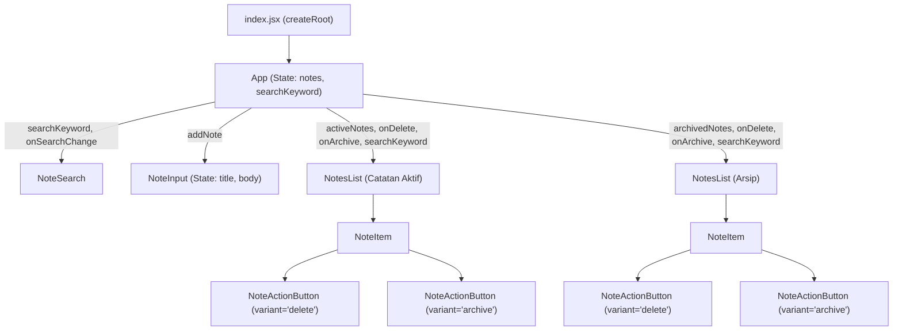

# 📝 My Personal Notes

[](https://react.dev/)
[](https://vite.dev/)
[](https://developer.mozilla.org/en-US/docs/Web/JavaScript)
[](https://developer.mozilla.org/en-US/docs/Web/CSS)
[](https://eslint.org/)

> **Proyek Akhir:** _Membangun Aplikasi Catatan Menggunakan React_  
> Program **Belajar Membuat Aplikasi Web dengan React** — **Dicoding Indonesia**  
> Kolaborasi Program **Asah led by Dicoding Supported by GoTo** & **PLK Akomodasi Klaim Universitas Negeri Yogyakarta (UNY) Studi Mandiri**.

---

## 📑 Daftar Isi

- [Tentang Proyek](#-tentang-proyek)
- [Kriteria Proyek Akhir & Fitur Lengkap](#-kriteria-proyek-akhir--fitur-lengkap)
  - [Kriteria 1: Penguasaan Array Function](#kriteria-1-penguasaan-array-function)
  - [Kriteria 2: Reusable & Modular Component](#kriteria-2-reusable--modular-component)
  - [Kriteria 3: State & Event Management](#kriteria-3-state--event-management)
  - [Kriteria 4: Controlled Form & Validasi Input](#kriteria-4-controlled-form--validasi-input)
  - [Fitur Tambahan & Peningkatan UI/UX](#fitur-tambahan--peningkatan-uiux)
- [Arsitektur Komponen & Props](#-arsitektur-komponen--props)
- [Struktur Data & Atribut Pengujian](#-struktur-data--atribut-pengujian)
- [Struktur Direktori](#-struktur-direktori)
- [Hierarki Komponen & Alur Data](#-hierarki-komponen--alur-data)
- [Teknologi yang Digunakan](#-teknologi-yang-digunakan)
- [Panduan Instalasi & Menjalankan Proyek](#-panduan-instalasi--menjalankan-proyek)
  - [Prasyarat](#prasyarat)
  - [Langkah Instalasi](#langkah-instalasi)
  - [Menjalankan Server Pengembangan](#menjalankan-server-pengembangan)
  - [Membangun & Pratinjau Produksi](#membangun--pratinjau-produksi)
  - [Skrip NPM](#skrip-npm)
- [Panduan Pengujian Fitur Aplikasi](#-panduan-pengujian-fitur-aplikasi)
  - [1. Pengujian Pembuatan Catatan & Batas Karakter](#1-pengujian-pembuatan-catatan--batas-karakter)
  - [2. Pengujian Pengarsipan & Pemindahan Catatan](#2-pengujian-pengarsipan--pemindahan-catatan)
  - [3. Pengujian Penghapusan Catatan & Empty State](#3-pengujian-penghapusan-catatan--empty-state)
  - [4. Pengujian Pencarian Real-Time & Penyorotan Teks](#4-pengujian-pencarian-real-time--penyorotan-teks)
- [Dokumentasi Arsitektur & Keputusan Teknis](#-dokumentasi-arsitektur--keputusan-teknis)
- [Developer](#-developer)

---

## 📖 Tentang Proyek

**My Personal Notes** adalah aplikasi web *Single-Page Application* (SPA) berbasis **React 19** dan **Vite** untuk mengelola catatan pribadi secara reaktif di sisi klien (*in-memory state*). Proyek ini dirancang untuk memenuhi seluruh kriteria wajib sekaligus kriteria nilai penuh (*Advanced*) pada submission kelas **Belajar Membuat Aplikasi Web dengan React** di Dicoding Academy, meliputi tiga kapabilitas utama:

1. **Manajemen Siklus Hidup Catatan Secara Reaktif:** Mendukung pembuatan catatan baru, pemisahan ruang kerja antara **Catatan Aktif** dan **Arsip**, pemindahan lintas status (*archive/unarchive*), serta penghapusan catatan secara *immutable* tanpa me-refresh halaman.
2. **Controlled Form dengan Validasi Real-Time:** Menyediakan formulir input terkendali penuh melalui React State yang membatasi judul maksimal **50 karakter** beserta penghitung sisa karakter langsung, serta memvalidasi isi catatan minimal **10 karakter**.
3. **Pencarian Instan, Pengelompokan Periode Bulanan, & Antarmuka Modern:** Dilengkapi pencarian *case-insensitive* secara *real-time* dengan penyorotan kata kunci (`<mark>`), pengelompokan catatan otomatis berdasarkan **Bulan & Tahun**, serta desain **Dark Glassmorphism** yang responsif di berbagai ukuran layar.

---

## 🏆 Kriteria Proyek Akhir & Fitur Lengkap

### Kriteria 1: Penguasaan Array Function

- **Pemanfaatan `Array.prototype.filter()`:**
  - Menghapus catatan dari state secara *immutable* berdasarkan kecocokan `id` (`prevState.notes.filter((note) => note.id !== id)`).
  - Menyaring daftar catatan secara dinamis berdasarkan kata kunci judul (`note.title.toLowerCase().includes(searchKeyword.toLowerCase())`).
  - Memisahkan daftar menjadi dua kategori independen: **Catatan Aktif** (`!note.archived`) dan **Arsip** (`note.archived`).
- **Pemanfaatan `Array.prototype.map()`:**
  - Membalik (*toggle*) properti `archived` pada catatan tertentu secara *immutable* tanpa mengubah elemen lainnya.
  - Merender daftar grup periode dan daftar kartu `NoteItem` menggunakan atribut `key` unik (`note.id`).
  - Memecah dan menyorot potongan teks pencarian yang cocok ke dalam elemen `<mark>`.
- **Pemanfaatan `Array.prototype.reduce()` & `sort()` *(Advanced)*:**
  - Mengurutkan catatan dari waktu pembuatan terbaru ke terlama (`new Date(b.createdAt) - new Date(a.createdAt)`).
  - Mengelompokkan catatan ke dalam seksi periode **Bulan & Tahun** berbahasa Indonesia lengkap dengan badge jumlah catatan pada setiap periode.

### Kriteria 2: Reusable & Modular Component

- Kode dipecah secara modular berdasarkan prinsip *Single Responsibility* ke dalam **6 komponen terpisah** di direktori `src/components/`:
  - `App.jsx` — Komponen akar pengelola state utama dan orkestrasi tata letak aplikasi.
  - `NoteSearch.jsx` — Komponen bilah pencarian *real-time* pada bagian header.
  - `NoteInput.jsx` — Komponen formulir penambahan catatan baru.
  - `NotesList.jsx` — Komponen daftar catatan *reusable* yang digunakan bersama untuk merender seksi **Catatan Aktif** maupun **Arsip**, lengkap dengan penanganan kondisi kosong (*empty state* `"Tidak ada catatan"`).
  - `NoteItem.jsx` — Komponen kartu representasi satu item catatan.
  - `NoteActionButton.jsx` — Komponen tombol aksi *reusable* berbasis prop `variant` (`delete` dan `archive`) serta `children`.

### Kriteria 3: State & Event Management

- **Lifting State Up:** Data utama (`notes` yang diinisialisasi dari `getInitialData()` dan `searchKeyword`) disimpan terpusat di komponen induk `App` sebagai *Single Source of Truth*.
- **Unidirectional Data Flow:** Data diturunkan ke komponen anak melalui *props*, sementara aksi pengguna dikirim kembali ke atas melalui *event handler callbacks* (`addNote`, `onDelete`, `onArchive`, `onSearchChange`).
- **Immutable State Updates:** Seluruh pembaruan koleksi catatan memanfaatkan *functional updater* `this.setState((prevState) => ...)` dengan *spread syntax* (`...`), `filter()`, dan `map()` sehingga tidak pernah memutasi state secara langsung.
- **ID & Timestamp Unik:** Setiap catatan baru dibekali `id` unik berbasis *timestamp* numerik (`+new Date()`) dan waktu pembuatan berstandar ISO 8601 (`new Date().toISOString()`).

### Kriteria 4: Controlled Form & Validasi Input

- **Controlled Component Murni:** Nilai kolom input judul (`title`) dan isi catatan (`body`) pada `NoteInput` dikendalikan sepenuhnya oleh `this.state` dan diperbarui melalui `onChange` handler.
- **Pembatasan 50 Karakter via State:** Batas panjang judul dikontrol langsung melalui logika JavaScript `if (event.target.value.length <= 50)` (bukan mengandalkan atribut HTML `maxLength`), diikuti indikator dinamis **`Sisa karakter: {remainingChars}`**.
- **Validasi Isi Catatan & Reset Otomatis:** Mencegah pengiriman catatan apabila panjang isi kurang dari **10 karakter** disertai pesan peringatan beranimasi *shake*, lalu mengosongkan kembali formulir setelah catatan berhasil ditambahkan.

### Fitur Tambahan & Peningkatan UI/UX

- **Keyword Highlighting (`<mark>`):** Menyoroti kata yang cocok secara visual baik pada judul maupun isi catatan ketika fitur pencarian digunakan.
- **Format Tanggal Lokal Indonesia:** Mengonversi tanggal ISO 8601 menjadi format ramah baca seperti `Selasa, 1 April 2025` menggunakan `toLocaleDateString('id-ID')` melalui utilitas `showFormattedDate`.
- **Desain Dark Glassmorphism & Responsif:** Mengusung tema gelap modern dengan *sticky blurred header*, aksen gradasi *amber*, ikon SVG inline ringan, serta tata letak CSS Grid adaptif (1 kolom di ponsel hingga 4 kolom di layar desktop lebar).
- **Standarisasi Kode Dicoding:** Mengintegrasikan `eslint-config-dicodingacademy` pada ESLint v9 Flat Config dan Prettier untuk menjaga konsistensi gaya penulisan kode JavaScript/JSX.

---

## 🧩 Arsitektur Komponen & Props

### Daftar Komponen React

| Komponen           | Tipe Component         | State Lokal           | Props yang Diterima                                                 | Tanggung Jawab Utama                                                                 |
| :----------------- | :--------------------- | :-------------------- | :------------------------------------------------------------------ | :----------------------------------------------------------------------------------- |
| `App`              | Class Component        | `notes`, `searchKeyword` | —                                                                | Menyimpan state utama, memfilter/mengurutkan catatan, dan menyediakan handler mutasi |
| `NoteSearch`       | Functional Component   | —                     | `searchKeyword`, `onSearchChange`                                   | Menerima input kata kunci pencarian catatan secara *real-time* di header             |
| `NoteInput`        | Controlled Class Comp. | `title`, `body`       | `addNote`                                                           | Mengelola form pembuatan catatan baru, sisa karakter judul (≤ 50), & validasi isi    |
| `NotesList`        | Functional Component   | —                     | `notes`, `onDelete`, `onArchive`, `searchKeyword`, `dataTestId`     | Merender pesan kosong atau mengelompokkan catatan per Bulan-Tahun beserta daftar item |
| `NoteItem`         | Functional Component   | —                     | `note`, `onDelete`, `onArchive`, `searchKeyword`                    | Menampilkan detail kartu catatan, penyorotan kata kunci, dan tombol aksi catatan     |
| `NoteActionButton` | Functional Component   | —                     | `variant`, `onClick`, `children`                                    | Komponen tombol aksi *reusable* untuk varian `delete` (`Hapus`) & `archive`          |

---

## 📦 Struktur Data & Atribut Pengujian

### Skema Objek Catatan (`note`)

```json
{
  "id": 1,
  "title": "Babel",
  "body": "Babel merupakan tools open-source yang digunakan untuk mengubah sintaks ECMAScript 2015+ menjadi sintaks yang didukung oleh JavaScript engine versi lama.",
  "createdAt": "2025-04-01T04:27:34.572Z",
  "archived": false
}
```

| Properti    | Tipe Data          | Keterangan                                                                                 |
| :---------- | :----------------- | :----------------------------------------------------------------------------------------- |
| `id`        | `number \| string` | Identitas unik catatan (`1–6` pada data awal, `+new Date()` pada catatan baru)             |
| `title`     | `string`           | Judul catatan (dibatasi maksimal **50 karakter** saat pembuatan catatan baru)              |
| `body`      | `string`           | Isi lengkap catatan (divalidasi minimal **10 karakter** saat pembuatan catatan baru)       |
| `createdAt` | `string`           | Waktu pembuatan catatan dalam format **ISO 8601**                                          |
| `archived`  | `boolean`          | Status pengarsipan catatan (`false` = Catatan Aktif, `true` = Arsip)                       |

### Kontrak Atribut `data-testid`

Seluruh elemen antarmuka dilengkapi atribut `data-testid` untuk memudahkan pengujian DOM terotomasi:

| `data-testid`                   | Komponen           | Deskripsi Elemen                                                  |
| :------------------------------ | :----------------- | :---------------------------------------------------------------- |
| `note-app`                      | `App`              | Kontainer utama aplikasi                                          |
| `note-app-header`               | `App`              | Bagian header aplikasi                                            |
| `note-search` / `note-search-input` | `NoteSearch`   | Kontainer & kolom input pencarian catatan                         |
| `note-input` / `note-input-form`| `NoteInput`        | Kontainer & elemen `<form>` tambah catatan                        |
| `note-input-title-remaining`    | `NoteInput`        | Indikator teks sisa karakter judul (`Sisa karakter: X`)           |
| `note-input-title-field`        | `NoteInput`        | Input teks judul catatan                                          |
| `note-input-body-field`         | `NoteInput`        | Textarea isi catatan                                              |
| `note-input-submit-button`      | `NoteInput`        | Tombol submit pembuatan catatan                                   |
| `active-notes-section` / `active-notes-list` | `App` / `NotesList` | Seksi & daftar untuk catatan berstatus aktif         |
| `archived-notes-section` / `archived-notes-list` | `App` / `NotesList` | Seksi & daftar untuk catatan berstatus terarsip  |
| `<dataTestId>-empty`            | `NotesList`        | Pesan `"Tidak ada catatan"` ketika daftar kosong                  |
| `<Bulan Tahun>-group`           | `NotesList`        | Seksi pengelompokan catatan per periode bulan dan tahun           |
| `note-item`                     | `NoteItem`         | Kartu item catatan (menyertakan atribut `data-note-id`)           |
| `note-item-title` / `date` / `body` | `NoteItem`     | Elemen judul, tanggal terformat, dan isi pada kartu catatan       |
| `note-item-delete-button`       | `NoteActionButton` | Tombol hapus catatan                                              |
| `note-item-archive-button`      | `NoteActionButton` | Tombol arsipkan / pindahkan catatan                               |

---

## 📂 Struktur Direktori

```text
my-personal-notes/
├── public/
│   └── vite.svg                      # Ikon publik aplikasi
├── src/
│   ├── components/
│   │   ├── App.jsx                   # Root Class Component (state utama, filter, sort & handler mutasi)
│   │   ├── NoteActionButton.jsx      # Reusable Functional Component tombol aksi (delete & archive)
│   │   ├── NoteInput.jsx             # Controlled Class Component form tambah catatan & batas 50 karakter
│   │   ├── NoteItem.jsx              # Kartu item catatan, format tanggal lokal & highlight kata kunci
│   │   ├── NoteSearch.jsx            # Functional Component bilah pencarian real-time di header
│   │   └── NotesList.jsx             # Reusable list catatan, empty state & pengelompokan Bulan-Tahun
│   ├── styles/
│   │   └── style.css                 # Styling global Dark Glassmorphism, animasi & CSS Grid responsif
│   ├── utils/
│   │   └── index.js                  # Data awal (getInitialData) & formatter tanggal (showFormattedDate)
│   └── index.jsx                     # Entry point aplikasi React DOM (createRoot)
├── .gitignore                        # Konfigurasi pengabaian berkas Git (node_modules, dist, .DS_Store)
├── .prettierrc                       # Konfigurasi format kode Prettier
├── eslint.config.js                  # Konfigurasi ESLint v9 Flat Config + Dicoding Academy Style
├── index.html                        # Dokumen HTML utama tempat mounting #root
├── package-lock.json                 # Lockfile pohon dependensi NPM
├── package.json                      # Metadata proyek, daftar dependensi & skrip NPM
├── vite.config.js                    # Konfigurasi bundler Vite & @vitejs/plugin-react
└── README.md                         # Dokumentasi lengkap proyek
```

---

## 🔄 Hierarki Komponen & Alur Data



---

## 💻 Teknologi yang Digunakan

- **Library UI:** [React](https://react.dev/) v19 (`react` & `react-dom`)
- **Build Tool & Dev Server:** [Vite](https://vite.dev/) v7 (`@vitejs/plugin-react`)
- **Bahasa Pemrograman:** JavaScript (ECMAScript 2022+ / ES Modules & JSX)
- **Styling:** Vanilla CSS3 (Custom Glassmorphism UI, CSS Grid & Flexbox Responsif, Keyframe Animations)
- **Linter & Kualitas Kode:** [ESLint](https://eslint.org/) v9 Flat Config, [`eslint-plugin-react`](https://github.com/jsx-eslint/eslint-plugin-react), [`eslint-config-dicodingacademy`](https://www.npmjs.com/package/eslint-config-dicodingacademy), & [Prettier](https://prettier.io/)

---

## 🛠️ Panduan Instalasi & Menjalankan Proyek

### Prasyarat

- **Node.js** versi **18 LTS** ke atas (direkomendasikan **Node.js v20 / v22 LTS**) beserta `npm`.
- Browser web modern (Chrome, Firefox, Safari, atau Edge).

### Langkah Instalasi

1. **Clone repositori ke komputer lokal:**

   ```bash
   git clone https://github.com/alfinhimawan/Proyek-Akhir-Membangun-Aplikasi-Catatan-Menggunakan-React.git
   cd Proyek-Akhir-Membangun-Aplikasi-Catatan-Menggunakan-React
   ```

2. **Pasang seluruh dependensi proyek:**

   ```bash
   npm install
   ```

### Menjalankan Server Pengembangan

Jalankan Vite *development server* dengan dukungan *Hot Module Replacement* (HMR):

```bash
npm run dev
```

Buka alamat lokal yang ditampilkan di terminal (umumnya `http://localhost:5173/`) pada browser.

### Membangun & Pratinjau Produksi

Untuk mengompilasi aplikasi ke direktori `dist/` yang telah teroptimasi dan mengujinya secara lokal:

```bash
npm run build
npm run serve
```

### Skrip NPM

| Perintah          | Fungsi                                                                 |
| :---------------- | :--------------------------------------------------------------------- |
| `npm run dev`     | Menjalankan server pengembangan lokal Vite dengan HMR (`localhost:5173`) |
| `npm run build`   | Mem-bundle dan mengoptimasi aplikasi produksi ke direktori `dist/`     |
| `npm run serve`   | Menjalankan pratinjau lokal hasil build produksi (`vite preview`)      |
| `npx eslint src`  | Memeriksa kepatuhan standar sintaks kode terhadap aturan ESLint        |

---

## 🧪 Panduan Pengujian Fitur Aplikasi

### 1. Pengujian Pembuatan Catatan & Batas Karakter

1. Ketik judul pada kolom **`Ini adalah judul ...`** dan amati teks **`Sisa karakter: 50`** berkurang secara *real-time* setiap karakter dimasukkan.
2. Coba ketik lebih dari **50 karakter** pada judul → Pastikan input berhenti menerima karakter tambahan saat sisa karakter mencapai **`0`**.
3. Ketik kurang dari 10 karakter pada kolom isi catatan → Pastikan pesan validasi **`Isi catatan minimal harus 10 karakter`** tampil dan form tidak terkirim saat tombol **Buat** ditekan.
4. Masukkan isi catatan minimal 10 karakter lalu klik **Buat** → Pastikan catatan baru langsung muncul di urutan teratas **Catatan Aktif**, penghitung `Catatan Aktif (N)` bertambah, dan kolom form kembali bersih.

### 2. Pengujian Pengarsipan & Pemindahan Catatan

1. Pada salah satu kartu di seksi **Catatan Aktif**, klik tombol **Arsipkan**.
2. Pastikan kartu berpindah seketika ke seksi **Arsip**, label tombol pada kartu tersebut berubah menjadi **Pindahkan**, dan jumlah pada judul masing-masing seksi diperbarui secara akurat.
3. Klik tombol **Pindahkan** pada kartu di seksi **Arsip** → Pastikan catatan kembali ke seksi **Catatan Aktif**.

### 3. Pengujian Penghapusan Catatan & Empty State

1. Klik tombol **Hapus** pada salah satu kartu catatan (baik pada **Catatan Aktif** maupun **Arsip**).
2. Pastikan kartu langsung terhapus dari state dan jumlah catatan berkurang seketika.
3. Apabila seluruh catatan pada suatu seksi dihapus atau dipindahkan (seperti kondisi awal pada seksi **Arsip**), pastikan pesan **`Tidak ada catatan`** ditampilkan dengan rapi.

### 4. Pengujian Pencarian Real-Time & Penyorotan Teks

1. Ketik kata kunci (contoh: `babel` atau `component`) pada kolom **`Cari catatan...`** di sudut kanan header.
2. Pastikan daftar **Catatan Aktif** maupun **Arsip** langsung menyaring catatan yang judulnya mengandung kata kunci tersebut (tidak peka huruf besar/kecil).
3. Pastikan kata kunci yang cocok pada judul maupun isi catatan tersorot menggunakan warna aksen kuning-amber (`<mark>`).
4. Kosongkan kembali kolom pencarian → Pastikan seluruh catatan tampil kembali seperti semula.

---

## 🏛️ Dokumentasi Arsitektur & Keputusan Teknis

### 1. Kombinasi Class Component & Functional Component

- Komponen yang membutuhkan pengelolaan *local state* (`App.jsx` dan `NoteInput.jsx`) diimplementasikan menggunakan **Class Component** (`extends React.Component`) lengkap dengan *method binding* eksplisit di dalam `constructor`. Pendekatan ini menunjukkan pemahaman mendalam terhadap fondasi siklus state dan OOP pada React.
- Komponen yang berfokus pada presentasi antarmuka dan perenderan data (`NoteSearch`, `NotesList`, `NoteItem`, `NoteActionButton`) dibangun menggunakan **Stateless Functional Component** agar bebas efek samping, mudah diuji, dan dapat digunakan ulang (*reusable*).

### 2. Immutability & Penghapusan Tanpa Pemblokiran Thread

- Seluruh operasi mutasi koleksi (`onAddNoteHandler`, `onDeleteHandler`, `onArchiveHandler`) ditulis secara murni (*pure*) di dalam *updater callback* `this.setState((prevState) => ...)` tanpa memodifikasi referensi array lama (`push` atau `splice` dihindari sepenuhnya).
- Handler `onDeleteHandler` langsung mengeksekusi `prevState.notes.filter((note) => note.id !== id)` tanpa dialog pemblokir browser seperti `window.confirm()`, sehingga menjamin responsivitas instan sekaligus kompatibilitas penuh dengan *headless browser automation* pada sistem pengujian submission.

### 3. Pembatasan Karakter Berbasis State (Bukan HTML `maxLength`)

- Alih-alih menyerahkan batasan karakter kepada atribut DOM tidak terkendali `maxLength="50"`, komponen `NoteInput` mencegat perubahan nilai langsung pada `onTitleChangeEventHandler` (`if (event.target.value.length <= 50)`). Dengan demikian, nilai yang tampil di layar selalu tersinkronisasi 100% dengan state internal React (*Single Source of Truth*).

### 4. Pengelompokan Dinamis Bulan-Tahun & Highlighting Aman

- Sebelum dirender di `NotesList`, koleksi catatan yang telah difilter dan diurutkan menurun dikelompokkan menggunakan `Array.prototype.reduce()` berdasarkan kunci lokal `Bulan Tahun` (`id-ID`). Pendekatan *derived data* di fase `render` ini menjaga struktur state utama `notes` tetap datar (*flat array*), sederhana, dan bebas duplikasi data.
- Fungsi `highlightText` pada `NoteItem` memisahkan teks menggunakan ekspresi reguler *case-insensitive* dan merendernya kembali sebagai elemen JSX `<mark>` standar (tanpa `dangerouslySetInnerHTML`), sehingga terhindar dari celah injeksi HTML/XSS.

---

## 👨‍💻 Developer

- **Nama:** Alfin Himawan Santosa
- **Program:** Asah led by Dicoding Supported by GoTo — PLK Akomodasi Klaim Universitas Negeri Yogyakarta (UNY) Studi Mandiri
- **Dicoding Profile:** [alfinhimawan](https://www.dicoding.com/users/alfinhimawan/academies)
- **GitHub:** [@alfinhimawan](https://github.com/alfinhimawan)
